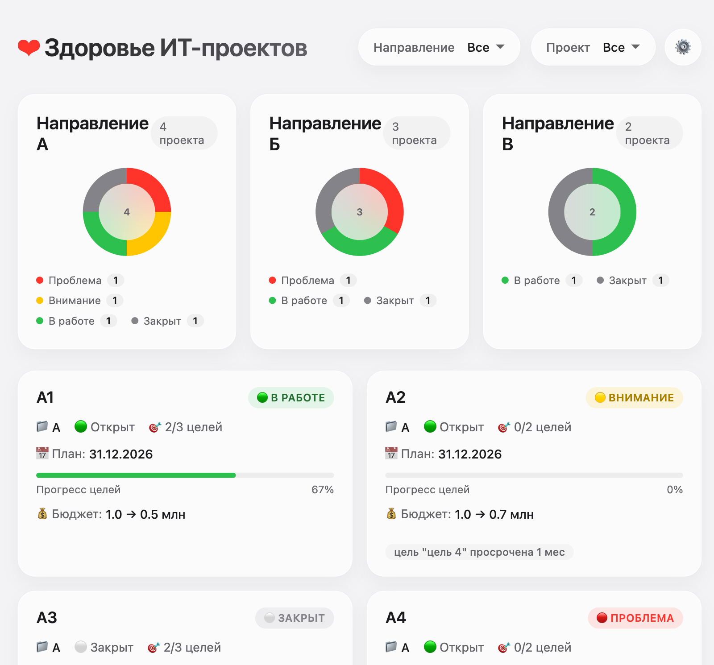

# Дашборд «Здоровье ИТ-проектов»

Один экран, который за 1–2 минуты отвечает на вопрос: **где портфель ИТ-проектов «горит», почему и что делать дальше.**



**Демо без установки:** https://volga7-alfa.github.io/it-projects-health-dashboard/

---

## Зачем это нужно

Руководителю приходится вручную собирать статусы проектов из таблиц и созвонов, а проблемы всплывают слишком поздно. Дашборд собирает всё в одном месте: светофор по проектам, прогресс целей, план/факт бюджета, просрочки и причины проблем.

## Что умеет

- **Карточки направлений** — сколько проектов в каждом и как они распределены по статусам (donut-диаграмма).
- **Карточки проектов** — цвет здоровья, прогресс целей, плановая дата закрытия, просрочка, план/факт бюджета и список причин проблемы.
- **Таблица всех целей** — направление, проект, статус, плановая дата и просрочка в месяцах.
- **Фильтры** — по направлению и проекту, плюс пять фильтров в таблице целей.
- **Загрузка Excel** — `.xlsx` / `.xls` перетаскиванием или через выбор файла.
- **AI-структурирование данных** — DeepSeek превращает строки Excel в проекты и цели.
- **Вопросы к данным** — чат по текущему срезу: «какие проекты в зоне риска и почему?».
- **Светлая и тёмная тема** — автоматически по настройке системы.
- **Адаптивная вёрстка** — карточки подстраиваются под ширину экрана.

## Как считается светофор

| Статус | Когда срабатывает |
|---|---|
| 🔴 Проблема | проект просрочен по дате закрытия **или** факт бюджета больше плана |
| 🟡 Внимание | до плановой даты меньше 3 месяцев, нет ни одной выполненной цели и бюджет уже израсходован или есть просроченные цели |
| ⚪ Закрыт | статус проекта «закрыт» |
| 🟢 В работе | остальные случаи |

Под каждой проблемной карточкой видно, какое правило сработало: например, «просрочка закрытия 3 мес» или «перерасход 1.2 млн».

## Технологии

- Чистый HTML, CSS и JavaScript — без сборки и фреймворков.
- [SheetJS](https://sheetjs.com/) для чтения Excel прямо в браузере.
- [DeepSeek API](https://api.deepseek.com/) для структурирования Excel и ответов на вопросы.
- Хранение данных — память браузера и `localStorage` (сохранение между сессиями запланировано в роадмапе).

## Запуск локально

Скачайте проект и откройте `index.html` в браузере. Всё, кроме работы с Excel и AI, работает сразу на демо-данных.

Если браузер ограничивает локальные файлы, запустите простой сервер:

```bash
python3 -m http.server 8000
```

и откройте http://localhost:8000.

Чтобы загрузить свой Excel или задать вопрос AI, откройте ⚙️ **Настройки** и сохраните API-ключ DeepSeek — он хранится только в вашем браузере.

## Данные и безопасность

- В репозитории лежат **только демо-данные**: 9 вымышленных проектов в трёх направлениях.
- API-ключ **не хранится в коде**: пользователь вводит его сам, ключ остаётся в `localStorage` браузера и отправляется только на `api.deepseek.com`.
- Для рабочего использования ключ стоит перенести на сервер — эта задача есть в роадмапе (US-17).

## Документация

- [План развития (ROADMAP)](docs/ROADMAP.md) — релизы 0.2.0–1.0.0, задачи и критерии приёмки.
- [Что уже сделано (CHANGELOG)](docs/CHANGELOG.md) — история изменений и известные ограничения.
- [Задачи](docs/tasks/) — описания задач, промпты и наброски экранов.

## Статус проекта

MVP 0.1.0: дашборд, импорт Excel, AI-чат. Дальше по плану — сохранение данных между сессиями, валидация Excel с предпросмотром и настраиваемые правила светофора.

Известные ограничения: данные не сохраняются после перезагрузки, правила светофора пока зашиты в код, нет автотестов и экспорта в PDF/Excel.

## Автор

[Volga7-alfa](https://github.com/Volga7-alfa)
